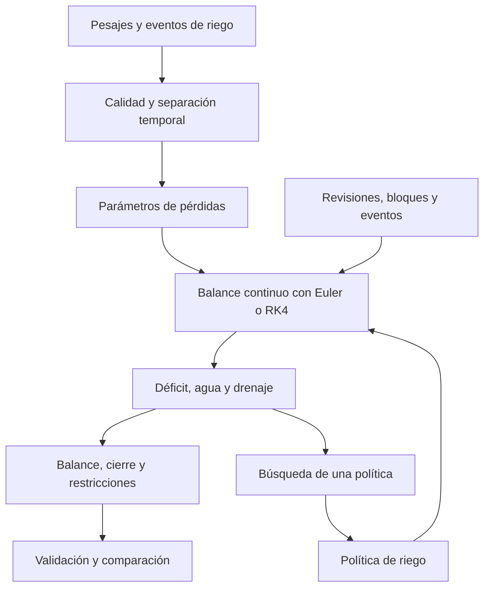

**Modelo de balance de agua y simulación**

**Estado y alcance**

Se modela una maceta mediante el déficit de agua respecto de una masa drenada de referencia. Se usa el mismo modelo físico al comparar políticas. Los valores del ejemplo son hipotéticos; los parámetros reales y el intervalo operacional todavía no están disponibles.

| Símbolo | Unidad | Significado y procedencia |
| --- | --- | --- |
| D | mL | Déficit: `(M_ref - M) / rho_w` |
| M, M_ref | g | Masa observada y referencia drenada, pendientes de medición |
| rho_w | g/mL | Densidad aproximada del agua; se adopta 1 como simplificación |
| a | mL/h | Pérdida a déficit cero, estimada en la fase de ajuste |
| b | 1/h | Dependencia local de la pérdida con el déficit |
| q_k | adimensional | Factor del bloque horario; el primer bloque se normaliza a 1 |
| u(t) | adimensional | Multiplicador externo de pérdidas; 1 en el caso de referencia |
| I, Q | mL | Riego aplicado y drenaje del evento |
| h | h | Paso máximo de integración |
| D_lim | mL | Límite operacional que debe justificarse con el piloto y la especie |

Se supone que los cambios de masa durante el horizonte se deben principalmente al agua. El modelo no representa crecimiento, salud vegetal, flujo espacial ni drenaje prolongado. Las lecturas negativas se conservan en los CSV originales; el estado físico inicial del simulador debe ser no negativo y cualquier corrección necesita una justificación independiente.

**Evolución continua**

$$\frac{dD}{dt}=u(t)q(t)\max(0,a+bD).$$

La pérdida agrupa evaporación y transpiración. Los bloques iniciales son día de 06:00 a 18:00 y noche de 18:00 a 06:00, en `America/Guatemala`. Ambos se pueden configurar. La carga de parámetros respeta el ámbito agrupado o por maceta de la calibración y comprueba su origen y estado.

Con `b = 0`, la solución en un tramo de duración T es `D(T) = D(0) + u*q*a*T`. Con `b` distinto de cero y pérdida activa, se usa como referencia analítica:

$$D(T)=D(0)+(a+bD(0))\frac{\exp(buqT)-1}{b}.$$

Si `a + bD` no es positivo, la pérdida es cero. Estas expresiones comprueban los integradores, pero la evolución del simulador se calcula con Euler o RK4.

**Riego y drenaje**

$$Q=\max(0,I-D^-),\qquad D^+=\max(0,D^--I).$$

Por tanto, `D+ - D- = Q - I`: la parte retenida repone el déficit y el excedente drena. Por ejemplo, un déficit de 40 mL y un riego de 60 mL producen un déficit de 0 mL y un drenaje de 20 mL.

El evento representa una aplicación efectiva con infiltración y drenaje instantáneos. Para reproducir observaciones, su tiempo corresponde al final del drenaje y se mantiene la evolución continua hasta ese instante una sola vez. Esto equivale a retrasar la aplicación efectiva durante el intervalo de drenaje; su error depende de la duración y de la pérdida. Antes de usar mediciones, se debe cuantificar esa aproximación con los residuos de los eventos. No se deben introducir simultáneamente el riego a la hora de aplicación y otro al final del drenaje. Si el error resulta relevante, se requiere un estado adicional de agua excedente y una tasa de drenaje.

En el ejemplo sintético los eventos son instantáneos en la hora de revisión. No se atribuye a ese ejemplo un tiempo de drenaje medido.

**Euler y RK4**

Para `f(t,D) = u(t)q(t)max(0,a+bD)`, Euler calcula:

$$D_{n+1}=D_n+h f(t_n,D_n).$$

RK4 calcula cuatro pendientes:

$$k_1=f(t_n,D_n),\quad k_2=f(t_n+h/2,D_n+hk_1/2),$$
$$k_3=f(t_n+h/2,D_n+hk_2/2),\quad k_4=f(t_n+h,D_n+hk_3),$$
$$D_{n+1}=D_n+\frac{h}{6}(k_1+2k_2+2k_3+k_4).$$

Euler tiene error global de orden uno y RK4 de orden cuatro en tramos suficientemente suaves, como se explica en las notas de [Euler](https://web.mit.edu/10.001/Web/Course_Notes/Differential_Equations_Notes/node3.html) y [Runge-Kutta](https://web.mit.edu/10.001/Web/Course_Notes/Differential_Equations_Notes/node5.html) de MIT. Los saltos de riego y los cambios horarios se procesan por separado. Cuando la tasa es constante dentro del bloque, ambos métodos coinciden salvo redondeo; no se añade complejidad para producir diferencias artificiales.

**Calendario y orden de eventos**

1. Se construye una lista ordenada con inicio, fin, revisiones, riegos registrados, observaciones, cambios de bloque y cambios de pérdidas.
2. Se integra hasta cada instante con pasos que no exceden `step_h`.
3. Se conserva el estado previo al evento y se actualiza el déficit máximo antes de aplicar agua.
4. Se obtiene la observación estimada y se consulta la política, o se aplica la dosis registrada.
5. Se actualizan riego, drenaje y déficit; se continúa en el bloque siguiente.
6. Al finalizar se realiza y contabiliza la reposición de cierre, si está habilitada.

En un corte horario, la última etapa de RK4 usa el factor del tramo que termina. El tramo siguiente comienza con el nuevo factor. Los instantes de decisión pertenecen a `[inicio, fin)`; el final se reserva al cierre. Una observación coincide con el estado previo al riego en ese instante. La trayectoria conserva además la fila posterior al evento mediante `stage`.

Solo se admite una de dos entradas: una política de riego o una secuencia de riegos registrados. Los eventos duplicados y los que quedan fuera del horizonte se rechazan. El calendario está verificado para Guatemala; no se utiliza en otra zona sin revisar los cambios de hora.

**Política fija**

`FixedPolicy` aplica una dosis constante en las horas y días seleccionados. El horario debe estar contenido en las horas de revisión. Se permite un intervalo entero entre días de riego; el día inicial del horizonte actúa como referencia en la ejecución con archivos. La dosis se define con el piloto, se justifica y se congela antes de optimizar. `configs/base.json` conserva los campos pendientes como valores nulos.

**Balance y comparación**

El control global calcula:

$$r=D_f-D_0-L+I_{total}-Q_{total},$$

donde L es la pérdida acumulada durante la evolución continua. El residuo debe aproximarse a cero. También se comparan trayectorias contra soluciones exactas: el balance por sí solo no demuestra que la tasa de pérdida sea correcta.

Se repone `max(0, D_final - D_inicial)` al final. Esa cantidad se incluye en `total_irrigation_ml`, en el límite por evento y en el presupuesto del día calendario que contiene el instante final. El cierre es una operación común al final del ensayo, separada de las revisiones ordinarias. Su momento y disponibilidad deben mantenerse iguales al comparar políticas. Si el déficit final es menor que el inicial, no se retira agua para forzar igualdad: `closure_ok` resulta falso y la comparación queda señalada como no equivalente.

No se recortan dosis que violan límites para ocultar incumplimientos. Se conserva la acción solicitada y se reporta su factibilidad. Los indicadores básicos comprueban déficit máximo, dosis máxima, presupuesto diario y cierre. Sin los tres límites definidos, `feasible` queda sin determinar. La verificación independiente de restricciones para PSO sigue pendiente.

Se reportan agua total y operacional, reposición final, drenaje, pérdida, déficit máximo, número de riegos y tiempo sobre el límite. Este último se estima interpolando linealmente dentro de cada paso continuo y debe revisarse con pasos menores cuando afecte una decisión.

**Interfaz de integración**

`simulate(model, config, policy=..., ...)` devuelve `SimulationResult` con `trajectory`, `events` y `metrics`. El optimizador solo necesita suministrar un objeto con `dose(timestamp, observed_deficit_ml)`; no debe modificar las ecuaciones ni recibir el déficit real como observación si se simula error de pesaje.

`irrigation_events` acepta `IrrigationEvent(timestamp, irrigation_ml, event_id)`. `observation_times` solicita instantes exactos para comparar predicciones. `loss_changes` acepta cambios de multiplicador externo por tramos. `observation_errors_ml` recibe errores previamente generados para cada revisión. La función no realiza sorteos internos: la generación y el registro de semillas corresponden al ejecutor experimental. Las políticas deben evitar estado mutable entre corridas o crearse de nuevo en cada ejecución.

Con `record_trajectory=False` se omiten las filas de evolución, conservando los eventos y las mismas métricas. Esto reduce el trabajo durante búsquedas repetidas. La versión con archivos guarda CSV, métricas JSON y hashes SHA-256 de las entradas. No depende de gráficas ni de PSO.

**Verificación reproducible**

```powershell
python -m pytest -q
python -m src.macetas validate-model
```

Se comprueban pérdida cero, tasa constante, solución exponencial, cortes horarios, riegos a tiempos irregulares, balance, reposición, presupuestos, observaciones, procedencia y conexión con la calibración.

Para `D(0)=5 mL`, `a=3 mL/h`, `b=-0.02 1/h`, `q=1` y 12 h, la referencia es 35.938960145350 mL. Se obtuvieron:

| Método | Paso (h) | Error absoluto final (mL) | Orden al dividir el paso |
| --- | ---: | ---: | ---: |
| Euler | 1 | 0.2771149131 | No aplica |
| Euler | 0.5 | 0.1377094376 | 1.0089 |
| Euler | 0.25 | 0.0686449404 | 1.0044 |
| RK4 | 1 | 3.7113e-8 | No aplica |
| RK4 | 0.5 | 2.3003e-9 | 4.0120 |
| RK4 | 0.25 | 1.4317e-10 | 4.0061 |

Las tablas completas se guardan en `results/verification/`. Se rechazan pasos que producen estados no finitos, descenso del déficit durante secado o sobrepaso numérico del equilibrio cuando `b < 0`.

El paso de 0.25 h es provisional. Después de calibrar, se deben comparar 1, 0.5 y 0.25 h con idénticas entradas y políticas, y elegir un paso cuyo efecto sobre las métricas sea pequeño frente al error de medición y a la diferencia entre políticas.

**Diagrama del sistema**



Los bloques de búsqueda y evaluación representan conexiones previstas; todavía no se dispone de PSO ni de validación real.

**Límites pendientes de contraste**

La referencia drenada no representa humedad absoluta ni garantiza salud vegetal. El modelo no identifica por separado evaporación y transpiración y no se debe extrapolar fuera del rango observado. La utilidad del drenaje instantáneo, la estabilidad de la masa de referencia, el límite operacional y el paso definitivo dependen del piloto. No se puede afirmar ahorro real a partir de la demostración sintética.

**Referencias**

Zeltkevic, M. (1998). *Forward and Backward Euler Methods*. MIT, 10.001. [Notas del curso](https://web.mit.edu/10.001/Web/Course_Notes/Differential_Equations_Notes/node3.html). Consulta: 2026-11-03.

Zeltkevic, M. (1998). *Runge-Kutta Methods*. MIT, 10.001. [Notas del curso](https://web.mit.edu/10.001/Web/Course_Notes/Differential_Equations_Notes/node5.html). Consulta: 2026-11-03.
